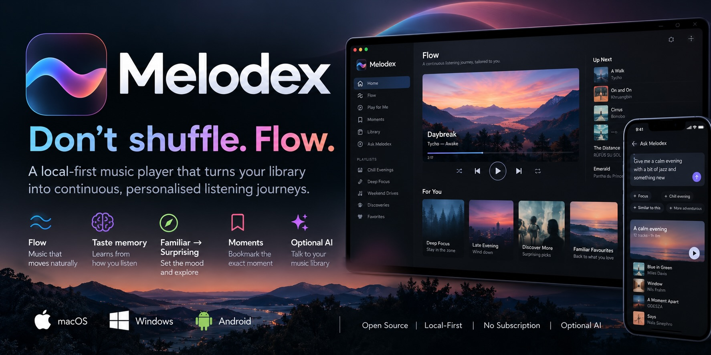
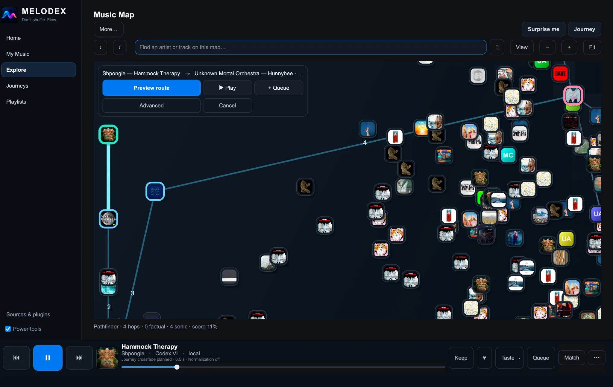
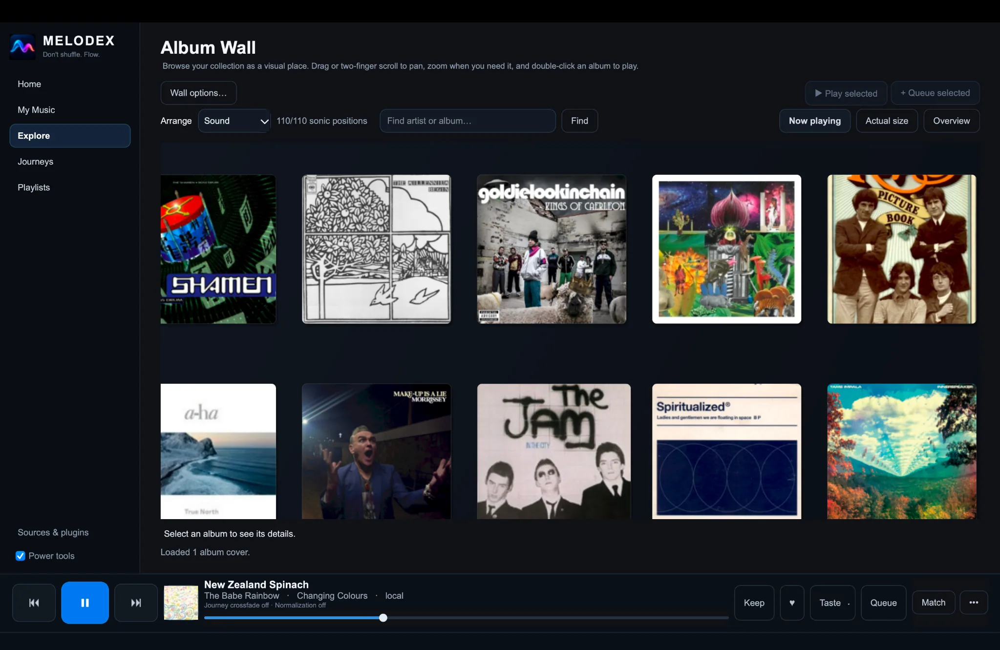
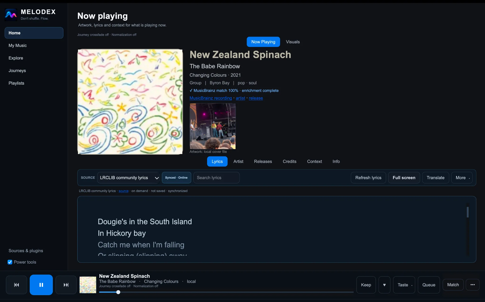
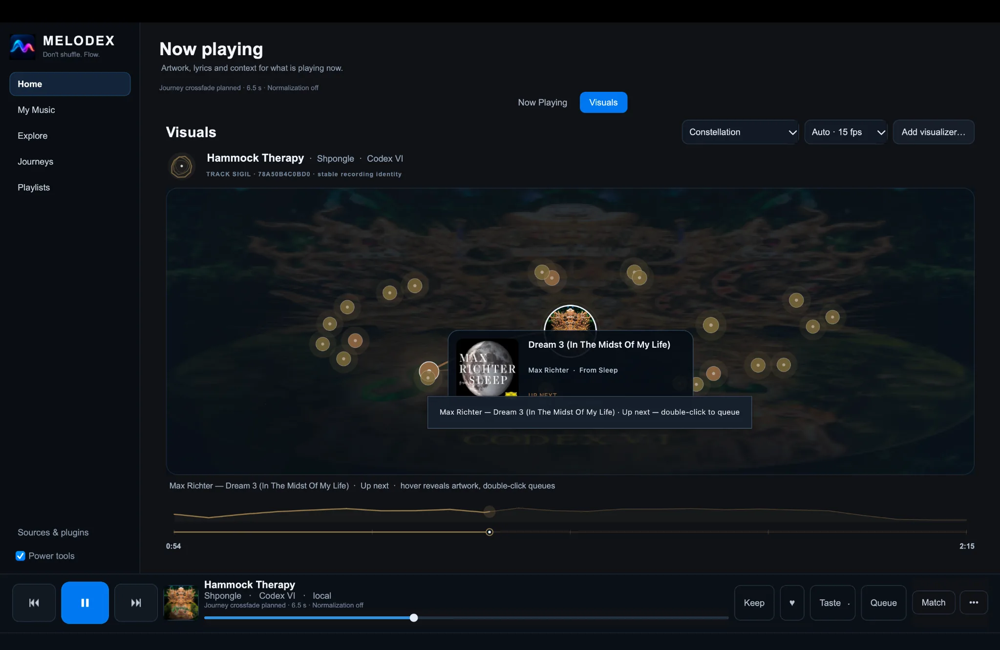

  

<h1 align="center">Melodex</h1>

<strong>Your music library, reimagined as a place to explore.</strong>

  An open-source, local-first music player with a visual Music Map, Album Wall and listening journeys.

  <a href="https://github.com/Cliff-Lee/melodex/releases/latest"><strong>Download the beta</strong></a> ·
  <a href="docs/START_HERE.md">Get started</a> ·
  <a href="docs/VISUAL_TOUR.md">Screenshots</a> ·
  <a href="docs/FAQ.md">FAQ</a> ·
  <a href="https://github.com/Cliff-Lee/melodex/issues/new?template=tester_feedback.yml">Share feedback</a>

  
  
  

## See your collection differently

**Music Map:** move between tracks, explore connections and preview a listening journey before you queue it.

**Album Wall:** navigate your music visually instead of scrolling through lists.

**Now Playing:** artwork, recording context, optional lyrics and interactive discovery visuals.

  
  

These are real screenshots from the v0.7.29 desktop app, not mockups. [View the six-screen tour](docs/VISUAL_TOUR.md).

## Why try Melodex?

- **Your files stay yours.** Play music from existing folders without moving or uploading it.
- **Play first, explore later.** No account, server, subscription or AI model is required for local playback.
- **Go beyond shuffle.** Follow track-to-track journeys, rediscover neglected music, or just play an album.
- **Discover while listening.** Explore cover-art clusters and nearby tracks with Music Map and Constellation.
- **Optional integrations.** Connected music sources and AI-assisted controls are available without becoming requirements.

Melodex does not bundle a commercial streaming catalogue. Connections on the Music Map can be heuristic sonic suggestions rather than verified factual links. [Read more about the approach](docs/WHY_MELODEX.md).

## Download and start playing

**[Download the latest Melodex release](https://github.com/Cliff-Lee/melodex/releases/latest)**

| Platform | Guide |
| --- | --- |
| macOS | [Install on macOS](docs/INSTALL_MACOS.md) |
| Windows | [Install on Windows](docs/INSTALL_WINDOWS.md) |
| Linux | [Install on Linux](docs/INSTALL_LINUX.md) |
| Android | [Android app and optional Bridge](docs/INSTALL_ANDROID.md) |

After installing, open **My Music → + Add music**, select a folder, then choose **Home → Play something**. You can explore **Music Map** and **Album Wall** whenever you like. No Python or Git setup is needed to use packaged releases.

> **Public beta:** The desktop app is the primary experience. macOS has received the most hands-on testing; Windows and Linux testers are especially welcome. Android supports local playback and optional Provider Bridge connectivity.
>
> **macOS installation note:** Current builds are not Developer ID signed or notarized. Follow the [app-specific first-launch instructions](docs/INSTALL_MACOS.md#3-macos-security-warning-unsigned-public-beta); do not disable Gatekeeper globally.

## Help shape the beta

Tried it? Even ten minutes of feedback helps. Tell us what worked, where you got stuck, and whether the map helped you find music you might otherwise have missed.

**[10-minute test guide](docs/TESTING.md)** · [Send feedback](https://github.com/Cliff-Lee/melodex/issues/new?template=tester_feedback.yml) · [Report a bug](https://github.com/Cliff-Lee/melodex/issues/new?template=bug_report.yml) · [Discuss the project](https://github.com/Cliff-Lee/melodex/discussions)

## Documentation and contributing

[Start here](docs/START_HERE.md) · [FAQ](docs/FAQ.md) · [Troubleshooting](docs/TROUBLESHOOTING.md) · [Privacy](docs/PRIVACY.md) · [Security](SECURITY.md)

Interested in contributing? See [CONTRIBUTING.md](CONTRIBUTING.md) or the [5-minute developer quickstart](docs/DEVELOPER_QUICKSTART.md). Development paths include desktop UI, Android, provider integrations, documentation and testing. The [developer gateway](docs/DEVELOPERS.md) and [full documentation index](docs/ALL_DOCUMENTATION.md) cover the deeper architecture and APIs.

Melodex is available under the [MIT License](LICENSE). Connected media remains subject to its source's rights and terms.
